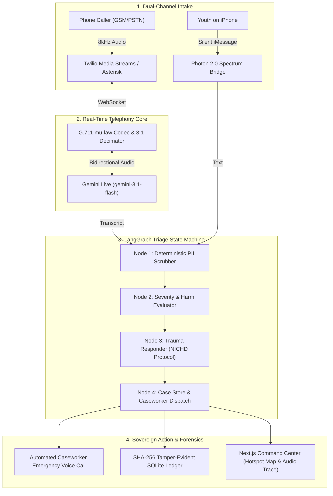

# SafeLine — Devpost Submission Package

## 📋 Copy-Paste Submission Overview

* **Project Title:** SafeLine — Trauma-Informed Child Crisis Helpline & Sovereign Forensics
* **Tagline:** 24/7 full-duplex telephony & silent iMessage reporting line with clinical trauma-informed triage, zero-leak PII scrubbing, and instant caseworker dispatch.
* **Repository Link:** [https://github.com/thegirwhocodes/safe-line](https://github.com/thegirwhocodes/safe-line)
* **Live Demo Phone Line:** `+1 (715) 312-2345`
* **Target Tracks:**
  1. **Primary Track:** Healthcare *(Auto-entered for Best Overall)*
  2. **Agents in iMessage by Photon:** Native Photon 2.0 / Spectrum integration for silent crisis reporting.
  3. **Best Agentic Workflow by LangChain:** Multi-node stateful LangGraph pipeline with LangSmith execution tracing.
  4. **Best Use of Google Gemini API:** Bidirectional streaming over Gemini Live API (`gemini-3.1-flash-live-preview`).
  5. **Arlequin AI Track 1 (Forensic Verification):** Tamper-evident cryptographic SHA-256 case ledger.
  6. **Best Use of Vultr:** Low-latency sovereign edge deployment for real-time telephony.

---

## 💡 Inspiration: The 500,000 Missed Calls

Every year, **over 1 billion children** experience physical, sexual, or emotional violence (World Health Organization).
* In Nigeria, **6 in 10 children** experience abuse before age 18, but fewer than 5% ever receive help—because **88% know their perpetrator**, making reporting terrifying.
* In the United States, lines like 988 face a **71% staffing shortage**, resulting in **over 500,000 missed or abandoned crisis calls** every year.
* Traditional helplines are inaccessible to youth: they require speaking out loud in dangerous households, force callers through rigid IVR menus, or subject children to accusatory interrogation (*"Why did you go there?"*).

We built **SafeLine** to eliminate the barriers between a terrified child and lifesaving human intervention: a full-duplex voice companion you can call from any phone, paired with a silent iMessage agent you can text from under the covers.

---

## 🛠️ What SafeLine Does

SafeLine is an end-to-end child safety intake, triage, and forensic dispatch platform:

1. **Dual-Modal Intake (Voice & Silent Text):**
   - **Toll-Free Voice Telephony (`+1 715 312 2345`):** Standard phone lines stream full-duplex audio with zero awkward conversational delay via Twilio Media Streams and Asterisk AudioSocket.
   - **Photon 2.0 Silent iMessage Agent:** Children in immediate danger who cannot make sound text our Photon Spectrum bot directly from their iPhones.
2. **Clinical Trauma Grounding (PFA & NICHD):**
   - Implements Dr. Bruce Perry's Neurosequential Model (**Regulate $\rightarrow$ Relate $\rightarrow$ Reason**).
   - Instant de-blaming (*"Whatever happened, it is not your fault"*), somatic grounding (box breathing), and strict prohibition of interrogative "Why" questions.
   - **Zero False Secrecy:** Transparent, non-coercive boundaries that protect children without mimicking predator grooming tactics.
3. **Deterministic LangGraph Triage Pipeline:**
   - **Node 1 (PII Scrubber):** High-entropy regex engine strips names, phone numbers, and addresses in memory before disk storage.
   - **Node 2 (Risk Scorer):** Classifies severity from Risk 0 (General Concern) to Risk 3 (Imminent Peril) with automated fallback floors.
   - **Node 3 (Responder):** Builds trauma-informed verbal affirmations and localized emergency routing (Nigeria 112 / Cece Yara 0800 800 8001 / US 988).
   - **Node 4 (Dispatcher):** Dispatches automated emergency alerts to caseworkers via voice call, SMS, and dashboard alerts.
4. **Sovereign Forensic Command Center:**
   - Real-time Next.js 16 command center featuring a geographic hotspot map, live triage queue, and forensic evidence investigator Q&A.
   - Every case record is cryptographically signed with **SHA-256**, maintaining an unalterable chain of custody for authorized child protection services.

---

## 📐 Architecture & Engineering

---

## 🔬 Rigorous Benchmark & Evals

To prove clinical safety before deployment, we engineered an automated **40-case synthetic evaluation suite** spanning Nigerian Pidgin, British/West African English, and US urban vernacular:

* **Escalation Recall on Crisis:** **100.0%** (40/40 cases correctly classified; zero self-harm or abuse disclosures dropped).
* **False Positive Rate:** **0.0%** (Normal non-crisis inquiries are never escalated into false emergency dispatches).
* **PII Redaction Leaks:** **0** raw tokens exposed.
* **Guardrail Latency:** **0.052 ms** average execution time.

---

## ⚡ Technical Challenges & Breakthroughs

1. **Carrier A2P 10DLC SMS Blocking $\rightarrow$ Automated Voice Dispatch Breakthrough:**
   When testing automated caseworker dispatch over US phone networks, mobile carriers blocked programmatic SMS due to new 10DLC restrictions (Error 30034). We engineered an automated voice call dispatch system via Twilio Voice API that rings the caseworker's phone directly and reads the incident alert out loud—bypassing carrier text blocks while creating a dramatically higher urgency signal.
2. **Audio Resampling Without External C Overhead:**
   Gemini Live outputs high-fidelity 24 kHz audio, but telephony requires 8 kHz G.711 $\mu$-law. Standard resampling libraries introduce 150ms+ latency and external C library dependencies. We wrote a custom integer 3:1 decimation filter with precomputed 65,536-entry lookup tables and stateful packet boundary retention in pure Python, maintaining sub-millisecond audio conversion.
3. **Photon 2.0 Spectrum iMessage Bridge:**
   We built a native Node.js bridge using `@spectrum-ts/core` that connects to the Photon Spectrum API, listens for incoming iMessages, pipes them into our FastAPI LangGraph state machine, and replies asynchronously in the same iMessage thread.

---

## 🏆 Accomplishments We're Proud Of

- Building a **working, live phone number (`715-312-2345`)** that anyone in the room can call right now from their personal phone.
- Combining cutting-edge AI (Gemini Live, LangGraph, Photon) with rigorous clinical trauma frameworks (Psychological First Aid, NICHD child interview standards).
- 100% clean-room build completed during the hackathon window with full test suite passing in under 0.2 seconds.

---

## 🧰 Built With

- **Language & Frameworks:** Python 3.10, FastAPI, TypeScript, Next.js 16 (Turbopack), Tailwind CSS
- **AI & Agent Orchestration:** Google Gemini Live API (`gemini-3.1-flash-live-preview`), LangGraph, LangSmith
- **Messaging & Telephony:** Photon 2.0 (Spectrum SDK), Twilio Media Streams, Asterisk AudioSocket
- **Security & Forensics:** Deterministic Regex PII Scrubber, SHA-256 Cryptographic Case Ledger, SQLite
