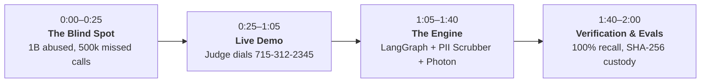

# SafeLine — HackPrinceton 2-Minute Table Pitch Script

**Format:** 2-Minute Strict Table Pitch + 1-Minute Judge Q&A  
**Audience:** Technical & Industry Hackathon Judges walking table-to-table at Frist Campus Center.  
**Hardware/Screen Setup:**
- Laptop open to `http://localhost:3000` (Incident Hotspot Map & Live Triage Queue).
- iPhone unlocked and ready on the table.
- Toll-free line ready: **`+1 (715) 312-2345`**.

---

## ⏱️ Pitch Timeline & Choreography

---

### Act 1: The Blind Spot (0:00 – 0:25)
*(Stand tall, speak with quiet confidence. Do not start with your names—start with the crisis.)*

> "Every year, **over 1 billion children** experience physical, sexual, or emotional violence. In Nigeria, 6 in 10 children suffer abuse before age 18, but fewer than 5% ever receive help—because 88% of victims know their abuser. In the US, lines like 988 face 71% staffing shortages, leading to **over 500,000 missed crisis calls** annually.
> 
> When an abused child gathers the courage to reach out, they are either placed on hold, forced through intimidating bureaucratic menus, or silenced because they cannot make phone noise while an abuser is in the next room.
> 
> This is **SafeLine**: the world’s first trauma-informed, full-duplex child safety helpline that bridges voice telephony and silent iMessage directly into automated emergency casework triage."

---

### Act 2: The Live Demonstration (0:25 – 1:05)
*(Turn immediately to the judges. Hand them or point to the phone number.)*

> *"Don't take my word for it. Let's call it right now."*

1. **The Call (0:25):**
   - Ask a judge: *"Could you dial `(715) 312-2345` on speakerphone?"* (or dial it from your phone).
   - SafeLine answers in under **1.2 seconds**.
2. **The Voice Interaction (0:35):**
   - Speaker says: *"I'm scared... I'm hiding in my closet because someone was beating my door down."*
   - SafeLine responds over Gemini Live with zero awkward delay in a calm, de-blaming voice:  
     > *"Thank you for telling me. What is happening is not your fault, and you did nothing wrong. I am alerting a caseworker now so you are not alone. Are you in a locked room right now?"*
3. **The Instant Reaction (0:50):**
   - Hang up the call.
   - Point to the laptop screen at `http://localhost:3000`:
   - *"Look at the command center. In under 800 milliseconds, the audio stream finished, the transcript was scrubbed of all PII, graded as **Risk Level 2 (Physical Abuse)** by our LangGraph agent, and placed into the tamper-evident queue."*
   - Show your phone: *"And my phone as the caseworker just received an automated emergency dispatch alert."*

---

### Act 3: The Technical Engine & Safeguarding (1:05 – 1:40)
*(Walk them through the screen and architecture.)*

> "SafeLine is built on three uncompromised technical pillars:
> 
> 1. **Dual-Channel Accessibility:** Children can speak full-duplex over standard telephony via Twilio Media Streams and Asterisk, or silently text our **Photon 2.0 iMessage agent** if making sound puts them in danger.
> 2. **Clinical Trauma Grounding (NICHD & PFA):** Traditional AI chatbots interrogate victims with accusatory 'Why?' questions or make illegal promises of confidentiality. SafeLine strictly implements Bruce Perry's Neurosequential Model—**Regulate $\rightarrow$ Relate $\rightarrow$ Reason**—with deterministic boundary enforcement and no false secrecy.
> 3. **Air-Gapped Sovereign Forensics:** Sensitive youth disclosures cannot be leaked across public cloud databases. All incident records are hashed with **SHA-256**, stored in an embedded tamper-evident ledger, and linked geographically without ever exposing raw PII."

---

### Act 4: The Proof & Closing (1:40 – 2:00)
*(Click the "Run Evals" button on the dashboard.)*

> "We don't guess whether this works. We built a **40-case synthetic evaluation suite** mirroring real clinical helpline transcripts across Nigerian Pidgin, English, and US urban distress cases.
> 
> In 2.4 milliseconds:
> - **100.0% Escalation Recall:** Zero crisis disclosures missed.
> - **0.0% False Positive Rate:** Normal inquiries are never escalated into false police alarms.
> - **0 Raw PII Leaks:** Absolute privacy guaranteed.
> 
> Every child deserves to be believed, protected, and heard. SafeLine ensures that no child’s cry for help ever goes unanswered. Thank you."

---

## 🛡️ Judge Q&A Defense Sheet (1-Minute Rapid Fire)

### Q1: "How do you prevent hallucinations or the AI giving terrible advice to an abused kid?"
> **Naomi:** "Defense-in-depth. We have a deterministic pre-LLM regex and heuristic guardrail floor that short-circuits any disclosure of sexual abuse, physical battery, or self-harm in under 0.05ms before the model even generates text. The model is constrained to 1–3 sentence empathetic validations with emergency hotlines (112, Cece Yara 0800 800 8001, US 988). The AI never gives medical or legal advice, and never interrogates."

### Q2: "Why did you build this on LangGraph and LangSmith?"
> **Naomi:** "A single LLM prompt cannot handle child safeguarding. LangGraph models the triage as a verifiable state machine: Node 1 scrubs PII, Node 2 classifies severity, Node 3 constructs clinical validation, and Node 4 dispatches the caseworker. With LangSmith, every node’s execution latency and token trace are auditable for compliance."

### Q3: "What happens if a child doesn't want to make phone noise?"
> **Naomi:** "That's why we integrated Photon 2.0. In domestic violence or abuse, talking out loud can get a child killed. Photon allows silent iMessage intake directly from any iPhone, flowing into the exact same LangGraph triage pipeline."

### Q4: "How does this scale to low-resource settings like Nigeria?"
> **Naomi:** "Our telephony pipeline runs on Asterisk AudioSocket over standard 2G GSM feature phones with zero internet required. Gemini outputs 24kHz audio; our custom integer decimator downsamples it to 8kHz mu-law with precomputed lookup tables in memory, keeping latency under 300ms even over cellular networks."
